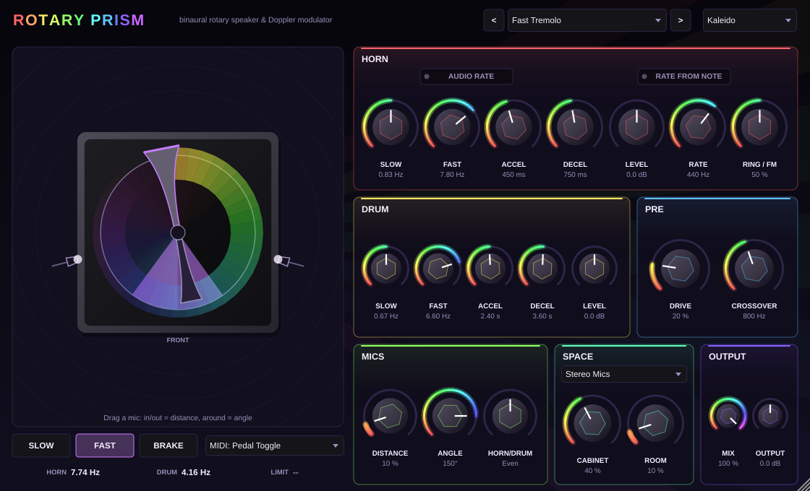

# Rotary Prism (working name)

A psychedelic stereo rotary speaker plugin (VST3 + AU + standalone). Horn and drum rotors have their
own speeds, acceleration and braking; two draggable virtual mics set distance and angle; a
**Binaural (Headphones)** mode spins the sources around your head; and the horn can be pushed past
real speeds into audio-rate ring modulation and FM, playable from MIDI notes. 22 presets, 6 UI
looks. See `docs/DESIGN.md`.



## Build

```
cmake -B build -DCMAKE_BUILD_TYPE=Release            # fetches JUCE 8.0.4
# or: cmake -B build -DJUCE_DIR=/path/to/JUCE
cmake --build build --config Release
ctest --test-dir build                                # engine tests
```

macOS builds target macOS 11+ universal (Intel + Apple Silicon) and add the AU format. No AVX2 or
other `-march` flags are used; the DSP is scalar C++. Windows builds use the static runtime.
GitHub Actions (`.github/workflows/build.yml`) builds both platforms, runs the tests, makes a
macOS `.pkg` and a Windows `Setup.exe`, and attaches them to a release when a `v*` tag is pushed.

Tools (optional): `-DROTARYPRISM_BUILD_SNAPSHOTS=ON` builds the UI screenshot tool
(`rotaryprism_snapshots <out-dir> [preset]`, run under `xvfb-run` on Linux).

Layout: `Source/engine` is plain C++ (rotor model, parameter table, presets) with tests in
`tests/`. `Source/engine/RotorCore.h` is the shared rotor model, kept identical to the copy that
Penumbra will use. `Source/plugin` is the JUCE wrapper and UI.
